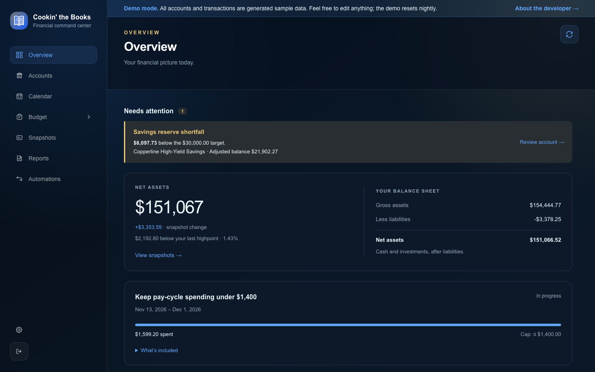
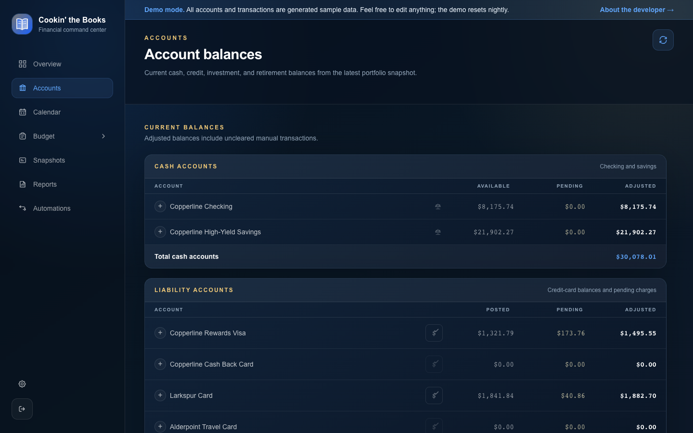
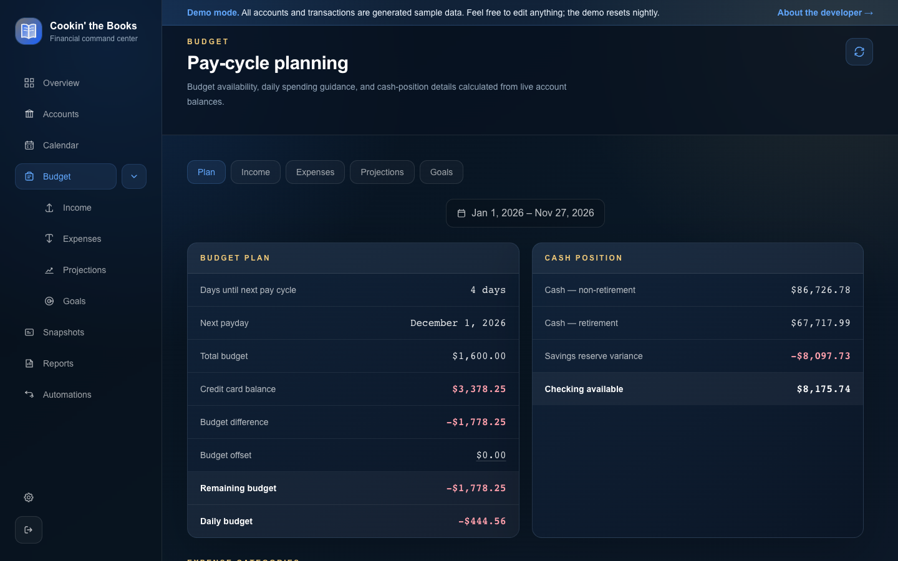
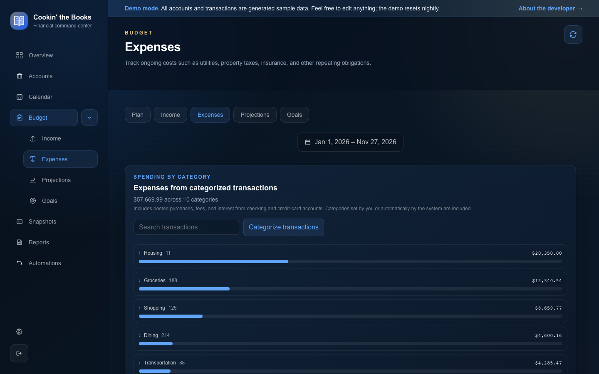
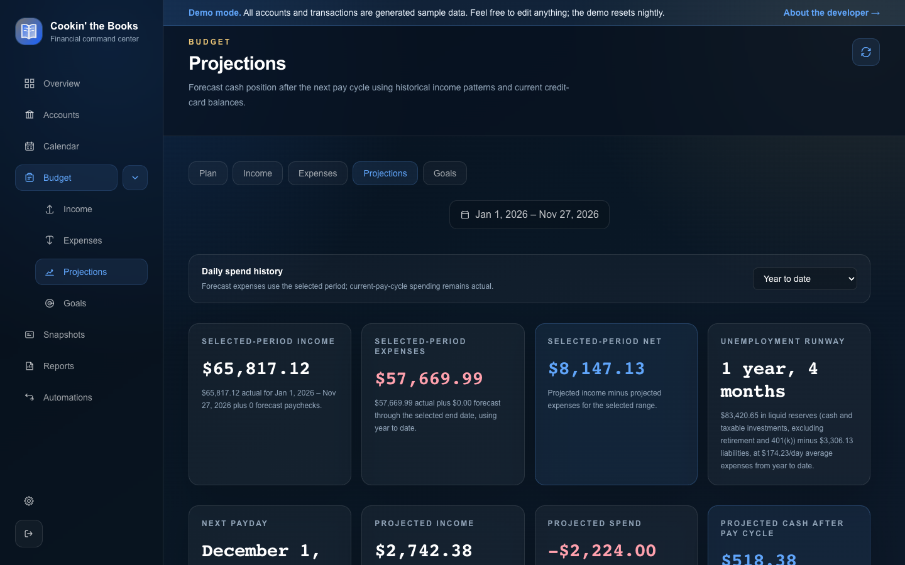
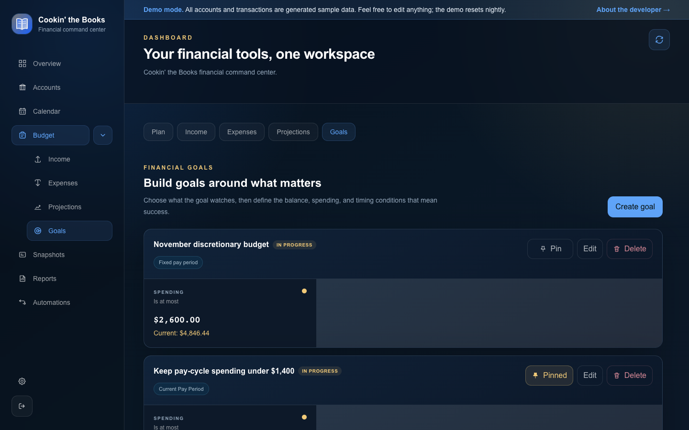
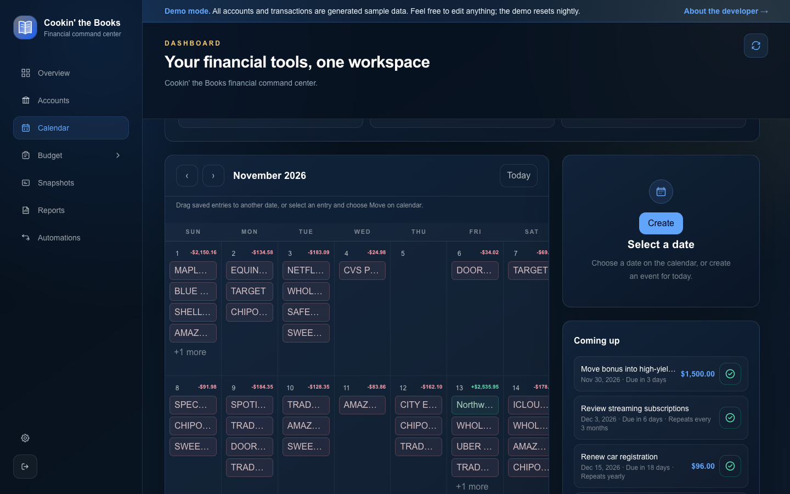
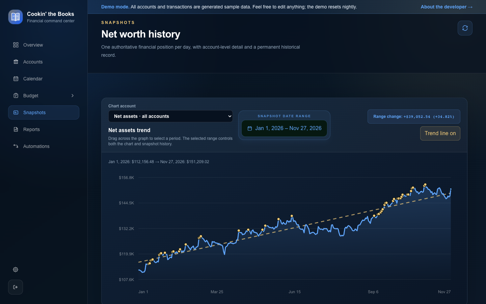

# Cookin' the Books

Personal finance dashboard that reads receipts with the Codex API and tags them onto bank transactions. Next.js, Django REST Framework, PostgreSQL, Plaid.

Cookin' the Books pulls bank and credit-card activity in through Plaid, matches
forwarded receipts and Amazon orders to the transactions they belong to, and
turns the result into a pay-cycle budget, net-worth history, forecasts, goals,
and a financial calendar.

**Try it:** [bengarlock.com/cookinthebooks/demo](https://bengarlock.com/cookinthebooks/demo)
signs you into a demo account with generated sample data. Edit anything; it
resets nightly.



## Features

### Accounts and transactions

- **Plaid sync** for checking, savings, credit-card, investment, and retirement
  accounts, with per-connection and sync-all refresh plus a sync activity log.
- **Account balances** with posted, pending, and adjusted totals. Adjusted
  balances include manual pending transactions you add yourself, which are
  reconciled when the real transaction posts.
- **Transaction editor** for categories, tags, notes, and budget treatment,
  with one-click automatic categorization and manual corrections.
- **Related transactions**: suggestions for linking refunds, payments, and
  other transactions that belong together.
- **Statement imports** from credit-card CSV and PDF statements, pay stubs, and
  housing and power bills.
- **Display names and links** for each account, used everywhere in the app.



### Receipts and orders

- **Receipt inbox**: forward receipt emails to a shared mailbox. Each one is
  parsed and matched to a card transaction, with retry, manual matching, and
  review for receipts that didn't match.
- **Line-item tagging**: tag individual receipt items, not only the whole
  transaction.
- **Amazon order history**: upload Amazon's order-history ZIP. It is imported
  in the background and matched to card transactions, optionally
  auto-categorizing new matches.

### Budget

- **Pay-cycle plan**: days until payday, total budget, credit-card balance,
  remaining budget, and a daily spending allowance, plus cash position and
  savings-reserve variance.
- **Income**: pay-statement history with gross pay, net pay, and withholdings,
  reconciled against deposits.
- **Expenses**: spending by category over any date range, with monthly
  averages, annual pace, and bulk categorization.
- **Projections**: next-paycheck forecast from median net pay, projected spend,
  projected cash after the pay cycle, and an unemployment-runway estimate.
- **Goals**: balance and spending targets with conditions over chosen accounts,
  transaction types, and periods. Pin a goal or its tracking metrics to the
  overview.









### Calendar and reminders

- **Financial calendar** showing daily transactions and totals alongside
  scheduled events. Events can repeat on flexible schedules and be dragged to a
  new date.
- **Recurring-expense suggestions** found from consistent merchant, amount, and
  timing patterns.
- **Reminders** by email, on the overview, or both, with completion and undo.



### Net worth, reports, and automations

- **Snapshots**: one locked financial position per day with account-level
  detail, an interactive net-assets chart with drag-to-select ranges, a trend
  line, and highpoint tracking. New snapshots reach the dashboard over a
  WebSocket without a page refresh.
- **Reports**: saved transaction views built from flexible selectors, with
  totals, a category breakdown, monthly spend, and year-over-year trends.
- **Automations**: rules that match transactions by description, amount,
  account, date, status, or pay period, then assign categories or tags, set
  budget treatment, or create expense entries. They run automatically after
  each import.



### Overview and settings

- **Overview** with a "needs attention" list, a balance sheet, upcoming
  reminders, pinned goals, and a tile layout you can rearrange.
- **Settings** for light and dark themes, notifications, categories, connected
  accounts, receipt forwarding, and Amazon data.

## Tech stack

- Next.js 16 (App Router), React 19, TypeScript, and Tailwind CSS 4
- Plaid Link (`react-plaid-link`) for bank connections
- Vitest for unit tests
- [`portfolio_database`](#authentication-flow) backend: Django REST Framework,
  PostgreSQL, Django Channels for live updates, and Celery for background
  imports, matching, and reminders

The app also uses:

- A fixed Next.js `basePath` of `/cookinthebooks`
- The existing `portfolio_database` token login and verification endpoints
- An HTTP-only cookie for the backend token
- Server-side session verification before dashboard content renders

## Authentication flow

1. The browser submits the username and password to
   `/cookinthebooks/api/auth/login`.
2. The Next.js route exchanges those credentials with
   `portfolio_database` at `/api/v1/login/`.
3. The returned backend token is stored in an HTTP-only, same-site cookie.
4. Protected dashboard layouts verify the token against
   `/api/v1/login/verify-token/`.
5. The browser never stores the backend token in `localStorage` or exposes it
   to client-side JavaScript.

The Next.js proxy performs a fast cookie-presence redirect, while the
dashboard layout performs the secure backend verification. Future financial
API routes should follow the same server-side proxy pattern.

## Local development

### Prerequisites

- Node.js 20.19+, 22.13+, or 24+
- npm
- A running `portfolio_database` instance

### Setup

```bash
cd /Users/bgarlock/WebstormProjects/cookin_the_books
npm install
cp .env.example .env.local
```

Update `.env.local` for the local backend:

```dotenv
NEXT_PUBLIC_API_BASE_URL=http://127.0.0.1:8000
PORTFOLIO_API_BASE_URL=http://127.0.0.1:8000
PORTFOLIO_WEBSOCKET_BASE_URL=ws://127.0.0.1:8000
AUTH_COOKIE_NAME=cookinTheBooksToken
AUTH_COOKIE_MAX_AGE_SECONDS=86400
```

`PORTFOLIO_API_BASE_URL` is preferred for server-side requests. Keep secrets
out of variables prefixed with `NEXT_PUBLIC_`; those values are embedded in
browser bundles.

`npm run dev` validates that both configured backend targets are loopback
addresses before starting. `npm start` performs the inverse production check:
it refuses loopback targets and requires HTTPS/WSS. This prevents a local
backend URL from surviving a production deployment while keeping environment
selection outside the committed application bundle.

Start the app:

```bash
npm run dev
```

Open:

```text
http://localhost:3000/cookinthebooks
```

The root route redirects unauthenticated users to
`/cookinthebooks/login`. Successful login redirects to
`/cookinthebooks/dashboard`.

## Validation

```bash
npm run lint
npm test
npm run build
```

## Future Jabba deployment

The expected server checkout is:

```text
/home/deploy/Projects/cookin_the_books
```

### Install and build

```bash
cd /home/deploy/Projects/cookin_the_books
npm ci
cp .env.example .env.production.local
```

Edit `.env.production.local` with the Jabba-accessible
`portfolio_database` URL. Do not commit this file.

```bash
npm run build
```

### Run with PM2

An `ecosystem.config.cjs` file is included:

```bash
pm2 start ecosystem.config.cjs
pm2 save
```

The default app port is `6433`. It can be changed in the PM2 environment
without changing application code.

### Reverse proxy

Configure the web server to preserve the `/cookinthebooks` prefix when
forwarding to Next.js. A representative Nginx location is:

```nginx
location /cookinthebooks/ {
    proxy_pass http://127.0.0.1:6433;
    proxy_http_version 1.1;
    proxy_set_header Host $host;
    proxy_set_header X-Forwarded-Host $host;
    proxy_set_header X-Forwarded-Proto $scheme;
    proxy_set_header X-Forwarded-For $proxy_add_x_forwarded_for;
}
```

The `proxy_pass` line intentionally has no trailing path component, allowing
Next.js to receive the configured base path.

## Environment variables

| Variable | Purpose |
| --- | --- |
| `NEXT_PUBLIC_API_BASE_URL` | Optional public API base URL for future direct browser requests |
| `PORTFOLIO_API_BASE_URL` | Preferred server-only base URL for `portfolio_database` |
| `AUTH_COOKIE_SECURE` | Optional cookie security override; defaults to `true` in production |
| `AUTH_COOKIE_DOMAIN` | Optional cookie domain override; set empty for host-only staging cookies |
| `PORTFOLIO_WEBSOCKET_BASE_URL` | Optional Channels/Daphne WebSocket origin; derived from the API URL when omitted |
| `AUTH_COOKIE_NAME` | Name of the HTTP-only backend-token cookie |
| `AUTH_COOKIE_MAX_AGE_SECONDS` | Browser cookie lifetime in seconds |
| `DEMO_USERNAME` / `DEMO_PASSWORD` | Optional demo account credentials; `/cookinthebooks/demo` returns 404 unless both are set |

No production URLs, credentials, or API tokens are committed to the project.

## Public demo

`https://bengarlock.com/cookinthebooks/demo` signs visitors into a demo account
with generated sample data and drops them on the dashboard. The route handler
(`src/app/demo/route.ts`) logs in with `DEMO_USERNAME` / `DEMO_PASSWORD` on the
server, so the credentials never reach the browser. Treat them as public
anyway: anyone can copy the session token out of their own browser.

The protections live in `portfolio_database`, not here:

- Users in the `demo` group can only reach `/api/v1/cookin_the_books/`. Every
  other app, the shared `bank-info` table, the server-management websocket,
  and realtime events reject them.
- Plaid, the receipt mailbox, file imports and OpenAI categorization are
  read-only or disabled for demo users, and reminder emails are never sent.
- `manage.py seed_demo_account` builds the account (it needs
  `DEMO_ACCOUNT_PASSWORD` the first time), and the Celery beat task
  `reset_cookin_books_demo_account` rebuilds it nightly, undoing visitor edits.

In this app, `verify-token`'s `is_demo` flag shows the demo banner and disables
the Plaid and receipt-mailbox controls. A `cookinTheBooksDemo` marker cookie
sends visitors whose demo session expired back through `/demo` instead of the
login form. Signing out clears the marker. Visiting `/demo` replaces any real
session in that browser, because the session cookie is shared across
`bengarlock.com`.

In production, PM2 starts the app through
`/home/deploy/.local/bin/cookin-the-books-op-exec` (see
`ecosystem.config.cjs`). That script reads the production 1Password
Environment on every start and passes the app only the settings it uses,
including `DEMO_USERNAME` / `DEMO_PASSWORD`, so they survive restarts and
reboots without being stored in PM2's saved process list. On DS9 staging,
`/home/deploy/.local/bin/cookin-the-books-staging-run` does the same with the
Staging Environment, passing only the demo credentials.

## Live snapshot updates

The overview loads the newest authenticated bank-value snapshot from
`portfolio_database`, then requests a short-lived WebSocket ticket through the
Next.js server. Browser JavaScript receives only that temporary ticket—not the
long-lived portfolio token.

The dashboard subscribes to:

```text
/ws/cookin-the-books/bank-value-snapshots/
```

When a new snapshot is accepted by the backend, Django Channels publishes it
to the authenticated user's private channel group. The dashboard updates
without a browser refresh and reconnects automatically after interruptions.
